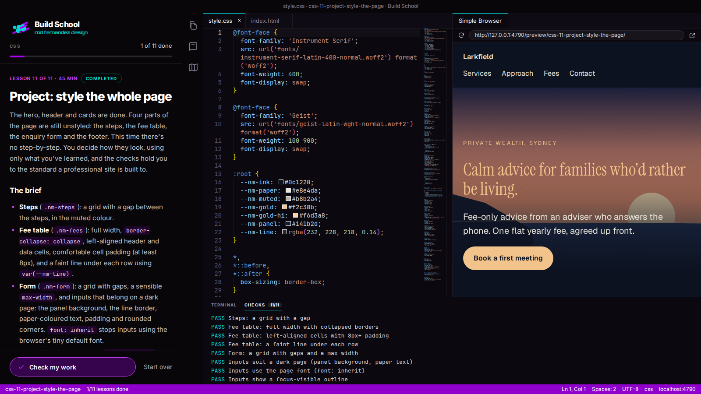

<p align="center"></p>

# Build School

**Learn to code by building real things, in an editor that looks and works like VS Code.**

Build School is a free, local learn-to-code app by [Rod Fernandez Design](https://rodfernandezdesign.com/). Each lesson sits beside a real workbench: the Monaco editor (the one inside VS Code), a file explorer, a working terminal and a live browser preview. You read the lesson, write the code, press **Check my work**, and the app tells you which goals pass.

It starts at your very first HTML tag. By the end you've built a dashboard with a database and a login, written Python and Rust tools, made scroll animations and 3D, and shipped work through CI with a quality gate.



## What you'll learn

**28 tracks, 212 lessons, about 130 hours**, in seven stages:

| Stage | Tracks |
|---|---|
| 1. The web, from the ground up | HTML · Terminal, files and Git · CSS · JavaScript |
| 2. Python: scripts that do the work | Python · APIs and keeping secrets safe · Servers, databases and scheduled jobs · Media pipelines (ffmpeg) |
| 3. Rust | Rust, from cargo to a desktop window with egui |
| 4. Motion, 3D and sound | GSAP · Canvas and scroll-scrubbed image sequences · Three.js · CPAL real-time audio |
| 5. The professional toolkit | TypeScript · Astro · Shipping on Netlify · Performance, SEO and accessibility · Browser automation with Playwright |
| 6. Frameworks and full apps | Tailwind CSS · React · Next.js · Dashboards and data (Recharts, Postgres, Supabase) · AI inside your apps · React Native (Expo) |
| 7. Production | Design for developers · Professional workflow · Rebuild from a brief · Shipping to production |

Every lesson has goals that are checked automatically, hints when you're stuck and a model answer. Most tracks end in a project. Stage 7 drops the step-by-step: you get a brief and an automated quality gate, the way real work arrives.

There are also **playgrounds** for the web, GSAP, Three.js, Python, Rust and CPAL, with no checks, just room to build. The **curriculum map** (the map icon) shows the whole journey and suggests a capstone project for many tracks.

## What you need

- **Node.js 22 or newer** and npm
- **Git**
- **Python 3.10 or newer** for Stage 2 and the terminal lessons
- **Rust** (stable, via [rustup](https://rustup.rs/)) for the Rust and CPAL tracks. On Linux, CPAL also needs the ALSA headers (`sudo apt install libasound2-dev pkg-config` on Ubuntu).
- **ffmpeg** for the media track

You don't need any of the language toolchains to start: the HTML, CSS and JavaScript tracks only need Node. Install the others when you reach them.

No lesson needs an API key, an account or a paid service. The API and AI lessons talk to small fake servers that run locally, databases run in-process (SQLite and PGlite), and no check plays sound, touches your crontab, systemd or ssh, or contacts a real service. Some lessons download packages the first time (`npm install`, `pip install`, cargo crates).

Build School is developed and tested on Ubuntu Linux. It should work on macOS. On Windows, run it inside WSL, because the terminal panel runs `bash`.

## Get started

```bash
git clone https://github.com/Rodvader8/build-school.git
cd build-school
npm install
npm run dev
```

Then open http://localhost:4780 and start with **HTML: Your first page**.

Your work is saved in `workspace/<lesson-id>/` as you type, and your progress in `workspace/progress.json`. Both are git-ignored, so pulling updates never touches them. You can open any lesson folder in the real VS Code too.

**It runs code on your computer.** That's the point (it's how Python, Rust and the terminal lessons work), so it only listens on `127.0.0.1` and refuses requests from any other website. Don't expose port 4780 to a network.

## How it works

`server/api.ts` is a Vite plugin that:

- copies a lesson's starter folder into `workspace/<lesson-id>/` the first time you open it (fonts and images included) and saves your edits there;
- serves your files at `/preview/<lesson-id>/` and the lessons' own starter and solution folders at `/curriculum/...` (for the tests), and `three` and `gsap` from `node_modules` at `/vendor/`;
- runs programs and streams their output: `python3` (or the lesson folder's own `.venv`), `cargo run` / `cargo test`, and Node;
- runs terminal commands (`/api/shell`) and dev servers for project lessons (`/api/dev`, one at a time, all stopped when the app stops).

**Security.** Because it can write files and run programs, the API only answers the app itself: the Host must be localhost (defeats DNS rebinding) and every write or run request must carry `X-Build-School: 1` (another website can't add that header without a CORS preflight, which is never approved). Programs the app launches get a clean environment: no `NODE_ENV` from Vite, and no `ANTHROPIC_*`, `CLAUDE*` or `OPENAI_*` variables from your shell, so a lesson only ever uses keys from its own git-ignored `.env`. Dev servers are stopped by lesson folder (some frameworks leave the process group they were started in).

Console output from the preview is forwarded to the terminal panel and kept in `window.__bsLog` for checks. Progress is in `workspace/progress.json`. `workspace/` is git-ignored, and you can open any lesson folder in real VS Code.

## Lesson kinds

| kind | What it is | How it's checked |
|---|---|---|
| `web` | HTML/CSS/JS served from the workspace | Checks read the preview's `doc` and `win` (computed styles, events, the console log) |
| `python` | A Python program | Checks read the output of `entry`, or of `checkEntry` (usually a visible `tests.py` printing `PASS name`) with `stdin` fed in |
| `rust` | A cargo project | Output of `cargo run`, or `cargo test` when `cargoTest: true` |
| `terminal` | Command-line and Git lessons | A Python `checkEntry` that inspects the folder |
| `node` | JavaScript or TypeScript run with Node | Output of `entry` or `checkEntry` |
| `project` | A full npm project with a dev server (`devCommand`, `devPort`) | A Node `checkEntry` script |

## Adding a lesson

Contributions are welcome: new lessons, fixes and translations. Make a folder `src/curriculum/<track>/<NN-slug>/` with:

- `lesson.md` - the lesson text (Markdown)
- `lesson.ts` - title, minutes, kind, entry file (the tab opened first), checks and hints, plus the kind's options above
- `starter/` - the files the student starts with (fonts and images can go in here too)
- `solution/` - the model answer

Checks get `doc`, `win`, the raw `files` and any program `output`; helpers for all of these are in `src/curriculum/helpers.ts`. Checks run in order and may be async. In the app, web checks run in a hidden 1200x800 frame, the same size the tests use, so results don't depend on the window size.

Track ids may contain dashes (`ai-apps`); the server matches the longest track folder. When a track is finished, `python3 scripts/mark-track-built.py <track>` marks it built on the map with the real lesson titles.

New tracks also go in `TRACKS` in `src/curriculum/index.ts`, and the map lives in `src/curriculum/map.ts`.

## Tests

`npm test` loads every web lesson's solution and starter in real headless Chromium, and runs every other lesson for real in a throwaway `workspace/test-*` copy (with `testSetup` first if the lesson has one). It proves each solution passes all its checks and each starter doesn't. Run it after writing or changing a lesson, or `npx vitest run -t "<track>-"` for one track.

Writing rules for lesson text: friendly and direct, contractions, British/Australian spelling, and never an em dash (the tests check).

## Licence

- **The app** is MIT licensed. See [LICENSE](LICENSE).
- **The curriculum** (`src/curriculum/`) is [CC BY-NC-SA 4.0](CONTENT-LICENSE.md): learn from it, teach with it and remix it, with credit, but don't sell it. The code you write while learning is yours.
- **Fonts** are under the SIL Open Font License. See [licenses/FONTS.md](licenses/FONTS.md).

## Name and logo

"Rod Fernandez Design", the wordmark and the logo mark aren't covered by either licence. You're welcome to fork Build School, but if you publish a changed version, please give it your own name and remove the logo from `public/brand/` and `public/favicon.png`.

---

Made by [Rod Fernandez Design](https://rodfernandezdesign.com/).
